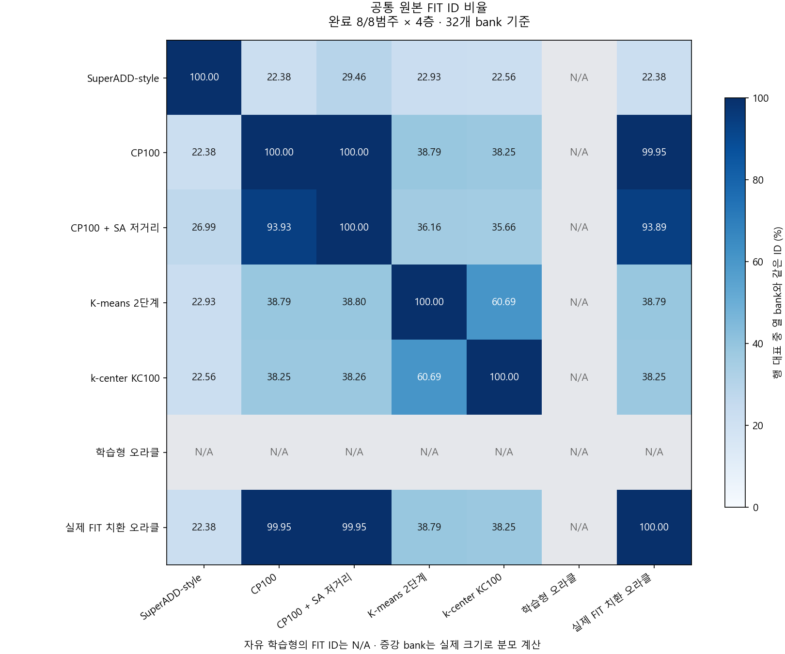

# CP100: MVTec AD 2에서의 정상 대표 선정 방식 연구

**Closest-Pair Pruning for Representative Selection on MVTec AD 2**

이 연구는 **같은 정상 특징 후보와 제한된 memory bank 예산에서 어떤 대표를 남겨야 하는가**를 다룬다. SuperADD의 밀도 기반 선정, PatchCore의 coreset 선정, 그리고 우리가 구현한 CP100을 비교하고, GT로 학습한 prototype 및 실제 정상 표본으로 치환한 결과와의 유사도를 분석한다. 핵심은 새로운 backbone을 제안하는 것이 아니라 **대표 선정 규칙과 그 평가 방법을 연구하는 것**이다.

공개 상태: 연구 코드·최종 8범주 집계·대표 기하 분석 공개본, 2026-11-12. 논문 게재나 독립 private-test 검증을 의미하지 않는다.

> **Abstract.** We study normal representative selection for memory-bank anomaly detection on MVTec AD 2. CP100 repeatedly prunes redundant nearest-neighbor pairs within sampled candidate subsets and retains 100,000 observed normal features per layer. We compare it with SuperADD-style density thinning, k-center selection, a two-stage K-means/CP variant, and PatchCore's approximate greedy coreset. We also inspect CP-initialized, ground-truth-optimized prototypes and their projection onto real normal features. The public-test evidence shows modest, setting-dependent gains; the oracle analysis is an in-sample diagnostic, not a global-optimality certificate.

## 1. 연구 질문과 기여

1. **대표 선정:** 밀도 기반 희소점 보존, k-center coverage, 가까운 쌍의 중복 제거는 anomaly score에 어떤 차이를 만드는가?
2. **통제 비교:** 같은 특징·bank 크기에서 selector만 바꿨을 때의 효과와, backbone·평가 조건이 다른 실험을 구분한다.
3. **대표의 유사도:** 같은 FIT ID, 실제 특징 위치, 내부 간격 분포를 각각 측정한다.
4. **오라클 진단:** 자유로운 prototype 좌표 학습과 실제 정상 표본의 부분집합 선택 사이의 차이를 확인한다.

CP100의 기술적 제안은 가까운 쌍에서 **상대점을 제외하고도 대체 이웃이 가까운 끝점**을 제거하는 규칙이다. 선행연구 전체에 대한 최초성은 이 공개본에서 확정하지 않는다.

## 2. 데이터셋: MVTec AD 2

[MVTec AD 2 공식 자료](https://www.mvtec.com/research-teaching/datasets/mvtec-ad-2)는 8개 산업 검사 시나리오와 8,000장 이상의 고해상도 영상을 제공한다. 정상 training/validation과 정상·결함 test가 있으며, 촬영 조명 변화와 미세 결함 등 어려운 조건을 포함한다. 공개 test는 pixel GT를 제공하고, private GT는 공식 평가 서버에서만 평가한다.

연구 대상은 `can`, `fabric`, `fruit_jelly`, `rice`, `sheet_metal`, `vial`, `wallplugs`, `walnuts` 전체다. 아래는 **DINO 실험에서 사용한 분할**이며 PatchCore 실험의 분할은 별도다.

| 범주 | 정상 FIT | train 내 정상 calibration | 공개 good | 공개 bad |
|---|---:|---:|---:|---:|
| can | 360 | 52 | 72 | 90 |
| fabric | 338 | 49 | 66 | 90 |
| fruit_jelly | 230 | 33 | 20 | 60 |
| rice | 273 | 40 | 42 | 90 |
| sheet_metal | 119 | 18 | 24 | 90 |
| vial | 254 | 37 | 35 | 105 |
| wallplugs | 256 | 37 | 60 | 90 |
| walnuts | 378 | 54 | 60 | 90 |

FIT은 대표 bank를 만드는 정상 부분집합이다. 공개 bad는 총 705장이다. can의 bad 90장은 15개 장면 × 6개 조명으로, 서로 독립인 90개 물체로 취급하지 않는다. 이 공개 test는 연구 개발에 반복 사용되었다.

데이터는 공식 경로에서 별도로 받아야 한다. 이 저장소는 이미지·GT·특징·학습 가중치를 포함하지 않는다. 데이터셋의 [CC BY-NC-SA 4.0 이용 조건](https://www.mvtec.com/research-teaching/datasets/mvtec-ad-2)을 따른다.

## 3. 기존 연구와 비교 대상

| 방법 | 대표를 남기는 관점 | 이 연구에서의 역할 |
|---|---|---|
| [PatchCore](https://openaccess.thecvf.com/content/CVPR2022/html/Roth_Towards_Total_Recall_in_Industrial_Anomaly_Detection_CVPR_2022_paper.html) | 정상 patch 특징의 greedy coreset으로 coverage 확보 | 원 논문의 대표 선정 배경 및 WRN 특징에서의 통제 대조 |
| [SuperADD](https://arxiv.org/abs/2605.14808) | k-NN 거리로 밀도를 추정하고 희소한 후보를 우선 보존 | DINO 특징에서의 SuperADD-style selector 및 별도 논문 보고값 |
| k-center KC100 | 선택 집합으로부터 먼 후보를 추가하는 coverage 관점 | DINO에서 100k 실제 정상 특징을 남기는 비교군 |
| K-means 2단계 + CP | 군집별 축약 후 전역 재축약 | 대표 선정 경로가 달라지는 비교군 |
| CP100 | 가까운 쌍의 대체 가능성을 비교해 중복 제거 | 우리의 대표 선정 방식 |

PatchCore는 정상 특징 memory bank를 greedy coreset으로 줄인다. 공식 구현에는 random projection과 approximate greedy sampler가 있다. SuperADD는 DINOv3 다층 특징, 겹치는 큰 이미지 patch, 밝기 augmentation과 후처리를 사용하며, 대표 선정에서는 k=100 이웃 거리의 평균 임계값 안에 있는 이웃 수가 적은 후보를 우선한다. [SuperADD 방법 절](https://arxiv.org/html/2605.14808v1), [PatchCore 공식 sampler](https://github.com/amazon-science/patchcore-inspection/blob/main/src/patchcore/sampler.py).

**SuperADD-style은 우리 특징 계보에서 구성한 로컬 선정 비교군이다. 공식 pretrained bank를 사용한 같은-run SuperADD 재실행으로 부르지 않는다.** 과거 stored pilot은 모든 표에서 제외했다. 문헌과 논문 수치는 [관련 연구](docs/RELATED_WORK.md)에 정리했다.

## 4. 제안 방법: CP100

### 4.1 특징과 예산

DINO 실험은 동결된 DINOv3 ViT-H+/16의 L7/15/23/31 **각각 1280D raw 특징**을 사용한다. 층을 연결하거나 L2 정규화하지 않는다. 저장 cache는 FP16, 선택·native 거리 계산은 FP32이며, 범주·층마다 실제 정상 FIT 벡터 100,000개를 남긴다. `100`은 대표를 생성하는 100회 부분집합 선택을 뜻한다.

### 4.2 부분집합과 가까운 쌍의 삭제

후보 수를 $N$이라 하면, seed 42의 `RandomState`로 아직 최종 선택되지 않은 ID 중 $\lfloor N/100\rfloor$개를 뽑는다. 각 부분집합에서 1,000개를 남기고 100회 합쳐 100k bank를 만든다. **탈락한 후보는 후속 부분집합에 다시 등장할 수 있다.** 처음부터 겹치지 않는 100개 partition을 만드는 절차가 아니다.

각 pruning round에서:

1. 활성 후보 각각의 자기 자신을 제외한 최근접 이웃 두 개를 구한다.
2. 각 점의 첫 이웃으로 만든 무방향 쌍을 거리와 global FIT ID 순으로 살핀다.
3. 쌍 $(i,j)$에 대해 상대점을 제외한 대체 거리 $e(i\mid j)=\min_{k\ne i,j}\lVert x_i-x_k\rVert_2^2$를 비교한다.
4. $e(i\mid j)$가 더 작은 끝점을 제거한다. 두 값이 같으면 global FIT ID가 더 큰 끝점을 제거한다.
5. 한 round에서 현재 점의 최대 20%만 제거하고, 이웃을 다시 계산한다. 목표 1,000개를 넘겨 제거하지 않는다.

한 round 안에서는 이웃이 고정되고 이미 제거된 끝점이 있는 쌍은 건너뛴다. 따라서 **전체 FIT pool의 전역 closest pair를 한 점씩 재계산하는 정확 알고리즘은 아니다.** 부분집합·batch 삭제를 사용하는 실용적 규칙이다. 부동소수점 이웃 동점의 순서는 라이브러리·장치의 영향도 받을 수 있다.

원본 구현: [cp_select.py](research/cp100/cp_select.py). 선택 규칙·동점·근사·연산량은 [방법 상세](docs/METHOD.md)에 설명한다.

### 4.3 이상 점수

각 층의 최종 bank를 $B_\ell$, 검사 특징을 $q_\ell(p)$라 하면,

$$
s(p)=\frac{1}{4}\sum_{\ell\in\{7,15,23,31\}}
\frac{\min_{b\in B_\ell}\lVert q_\ell(p)-b\rVert_2}{\sqrt{1280}}.
$$

**추론은 전체 100k bank에서 단일 1-NN을 구한 뒤 네 층을 평균한다.** 대표를 생성한 100개 부분집합별 점수 평균이나 binary vote를 사용하지 않는다. 부분집합 평균을 쓰는 과거 별도 실험과 구분한다. 이 main comparison에는 정렬·relation branch·GT 선택 threshold·morphology가 없다.

## 5. 실험 설계

| 실험 | 특징·대표 예산 | 평가 범위 | 해석 |
|---|---|---|---|
| A. DINO 대표 선정 비교 | raw1280D × 4층, 대부분 층당100k | 공개 bad-only, 범주별 pixel pooling 후 8범주 평균 | 보존된 역사 평가의 같은 범위 재집계 |
| B. PatchCore selector 교체 | WRN50-2 1024D, 같은128D 선택 projection, 100k | 공개 good+bad, FP32, 별도 평가 | 같은 실행에서 selector만 바꾼 통제 실험 |
| C. 오라클·기하 | A의 CP100에서 시작, 자유좌표/실제 FIT 치환 | 같은 공개 GT로 학습·checkpoint 선정·평가 | in-sample 진단 |

DINO main의 pAUROC@0.05는 sklearn의 **표준화 partial AUROC**다. AU-PRO@0.05는 8-connected GT component를 같은 가중치로 평균한 recall 곡선을 FPR 0.05까지 적분·정규화한다. 둘은 다른 지표다. 원본의 quarter grid와 `INTER_LINEAR → GT>0`, FP16 ranking을 사용한다.

A의 모든 방법을 새 공통 runtime에서 다시 추론한 것은 아니다. CP 기준점은 오라클 평가와 범주별로 exact 일치했지만, KC100의 과거 native 거리에는 같은 FIT ID에서도 차이가 관측되어 **선정 정책만의 완전한 인과 비교로 확대하지 않는다**. [평가와 수치 계약](docs/EVALUATION.md), [출처·재현 범위](docs/REPRODUCIBILITY.md).

### 5.1 DINO 대표 선정: 8범주 평균

모든 값은 %, 차이는 percentage point이다. 위쪽 5행은 정상 데이터로 bank를 만들었고 아래 2행은 GT 사용 진단이다. CP100+SA 저거리 추가는 **100k를 초과하므로 동일 예산 비교군이 아니다**. KC100 AU-PRO는 해당 역사 평가에 없어 N/A로 남겼다.

| 방식 | pAUROC@0.05 ↑ | AU-PRO@0.05 ↑ | 공개 GT로 bank 학습 |
|---|---:|---:|---|
| SuperADD-style | 83.5931 | 51.2279 | 아니오 |
| **CP100** | **84.2729** | **51.6859** | 아니오 |
| CP100 + SA 저거리 추가 | 84.2441 | 51.9594 | 아니오 |
| K-means 2단계 + CP100 | 84.1240 | 49.7150 | 아니오 |
| k-center KC100 | 84.2080 | N/A | 아니오 |
| GT 자유 학습 prototype | 96.3487 | 97.7524 | **예: in-sample** |
| GT 학습 후 실제 FIT 치환 | 84.3188 | 52.0260 | **예: in-sample** |

CP100과 로컬 SuperADD-style의 차이는 pAUROC **+0.6798%p**, AU-PRO **+0.4580%p**다. 이 표만으로 독립 test 우위나 통계적 유의를 주장하지 않는다. K-means 2단계는 **KMeans100 → 군집 내부 CP로 총200k → 전역 CP100k**이며, 100k centroid를 학습한 방법이 아니다.

출처: [평균 CSV](results/dino/performance_macro.csv), [56개 범주·방법 결과](results/dino/per_category.csv).

### 5.2 DINO 범주별 결과: SuperADD-style → CP100

| 범주 | SA-style pAUROC | CP100 pAUROC | SA-style AU-PRO | CP100 AU-PRO |
|---|---:|---:|---:|---:|
| can | 50.0397 | 50.9617 | 1.5539 | 3.4158 |
| fabric | 84.0505 | 86.9010 | 73.0496 | 70.8861 |
| fruit_jelly | 81.1968 | 81.4261 | 24.6104 | 25.9637 |
| rice | 95.9668 | 96.5662 | 71.6268 | 75.2047 |
| sheet_metal | 92.8941 | 93.2012 | 50.7497 | 50.5007 |
| vial | 82.2171 | 83.1369 | 84.2989 | 84.4020 |
| wallplugs | 92.1496 | 91.8465 | 63.8483 | 62.9766 |
| walnuts | 90.2302 | 90.1435 | 40.0857 | 40.1378 |

개선은 범주·지표에 따라 다르다. 특히 can의 CP100 AU-PRO는 여전히 낮다.

### 5.3 SuperADD 논문의 별도 참고값

아래는 [SuperADD 원 논문 Table 1](https://arxiv.org/html/2605.14808v1)의 **paper-reported reference**이다. 로컬 재실행 결과와 섞어 순위를 매기거나 차이를 계산하지 않는다. fixed F1은 위의 rank-only 실험에서 산출하지 않았다.

| 출처·범위 | pAUROC@0.05 | fixed pixel F1 | AU-PRO@0.05 |
|---|---:|---:|---:|
| SuperADD paper-reported, can | 51.61 | 0.00 | N/A |
| SuperADD paper-reported, 8범주 평균 | 83.93 | 62.61 | N/A |

### 5.4 PatchCore의 대표 선정 규칙과 통제 비교

WRN50-2의 공식 layer2+layer3, 3×3 patch, 1024D fused 특징을 한 번 추출하고, **같은1024→128D random projection**에서 CP100과 공식 approximate greedy coreset을 비교했다. 두 방법은 각각100k 실제 정상 특징을 선택하고 원래1024D에서 exhaustive FP32 squared-L2 1-NN을 계산했다. 입력은256×256 전체 화면, seed42다.

| 지표 | CP100 | coreset-100k | CP − coreset (%p) |
|---|---:|---:|---:|
| AU-PRO@0.05 | 23.3465 | 23.0747 | +0.2718 |
| AU-PRO@0.30 | 46.5825 | 47.3260 | −0.7435 |
| pixel AUROC | 84.6376 | 85.4562 | −0.8187 |
| 표준화 pixel pAUROC@0.05 | 68.1527 | 68.1288 | +0.0239 |
| 정상 validation Q99 F1 | 13.3913 | 13.4393 | −0.0479 |

주 지표 AU-PRO@0.05의 범주별 결과는 **4승4패**다. 일관된 검출 성능 우위는 확인하지 못했다. 저장 특징에서의 대표 선택·bank 저장은 총40.79초 대178.87초였지만, 한 실행의 단계 시간이며 일반적인 end-to-end 속도 주장이 아니다.

이 실험은 공식 PatchCore 기본1% bank나 MVTec AD 2 논문의 ensemble 재현이 아니다. DINO 실험과는 backbone·분할·score dtype·평가 모집단이 달라 두 표의 성능 차이를 selector 효과로 해석하지 않는다. Q99 F1은 good+bad pooled 값으로 SuperADD 논문 fixed F1과 직접 비교하지 않는다. [PatchCore 실험 상세](docs/PATCHCORE.md), [범주별 CSV](results/patchcore/per_category.csv).

## 6. 오라클과의 유사도: 무엇을 비교하는가?

### 6.1 오라클의 구성

**학습형**은 CP100에서 시작해 backbone을 고정한 채 FP32 prototype 좌표만 학습한다. GT component 균등 결함 표본과 정상·hard background에 대해 normal pull, anomaly push, pair ranking loss를 사용한다. SparseAdam2000step, 저장 checkpoint 중 실제 AU-PRO가 가장 높은 것을 선택했다.

**치환형**은 학습 좌표마다 전체 정상 FIT에서 FP64 exhaustive 최근접 후보를 찾고, 결정적 충돌 해소로 층당100k 고유 실제 FIT ID를 배정한다. 이후 재학습하지 않는다. 전체 후보를 검색했지만 전역 최소비용 일대일 assignment를 보장하지 않는다.

### 6.2 실제 FIT 치환형과의 ID 유사도

각 범주·층의 비율을 계산한 뒤 **32bank를 같은 가중치로 평균**했다. 열의 분모가 다르다.

| 비교 방식 A | A 중 치환형과 공유 (%) | 치환형 중 A와 공유 (%) | Jaccard (%) |
|---|---:|---:|---:|
| SuperADD-style | 22.3754 | 22.3754 | 12.8688 |
| **CP100** | **99.9508** | **99.9508** | **99.9017** |
| CP100 + SA 저거리 추가 | 93.8888 | 99.9512 | 93.8477 |
| K-means 2단계 + CP100 | 38.7911 | 38.7911 | 24.6817 |
| k-center KC100 | 38.2514 | 38.2514 | 24.2687 |
| 자유 학습 prototype | N/A | N/A | N/A |

자유좌표 prototype에는 FIT ID가 없다. 초기 CP100 row label을 실제 정상 표본 ID처럼 취급하지 않는다. 원래 CP와 좌표가 정확히 같은 prototype 비율은 평균35.1386%였다.



### 6.3 실제 특징 공간의 위치 유사도

7방법 × 8범주 × 4층의 모든21쌍, **672쌍·1,344방향**을 전체1280D bank에 대해 exhaustive FP64로 비교했다. 거리 단위는 Euclidean/√1280이다. 공유 FIT ID도 검색에 포함하며, 비공유 대표 조건부 통계는 source query만 제외한다. 최근접 대응은 다대일을 허용한다.

| CP100 → 비교 대상 | CP 방향 상호 최근접 비율, 32bank 평균 |
|---|---:|
| K-means 2단계 + CP100 | 58.18094% |
| k-center KC100 | 58.45172% |
| 자유 학습 prototype | 99.98800% |
| 실제 FIT 치환형 | 99.98722% |

ID 중복, 교차 NN 거리, 상호 NN, Hausdorff, 내부 NN 간격 CDF는 서로 다른 측정이다. 평균 거리가 작거나 내부 histogram이 비슷해도, 결함 query 근처의 국소 배치와 점수 순위까지 같다는 뜻은 아니다. [오라클·기하 해석](docs/ORACLE_ANALYSIS.md), [672쌍 CSV](results/geometry/cross_pairs_672.csv), [1,344방향 CSV](results/geometry/cross_directional_1344.csv).

**99.95% ID 일치는 CP100의 전역 최적성을 증명하지 않는다.** 오라클은 CP100에서 시작했고 같은 GT로 학습·선정·평가했다. 자유좌표에서 높은 in-sample 성능을 얻었지만 정상 표본으로 치환하면 CP에 가까워진 것은 이번 절차의 관측이다. 모든 이산 대표 선택의 한계나 미지 결함 일반화로 확대할 수 없다.

## 7. 재현과 공개 코드

```text
cp100/              .npy 특징 pool용 portable 선택·1NN CLI
research/cp100/     보존된 원본 CP100 선택·추론·완료 검증 코드
research/oracle/    원본 prototype 학습·고유 FIT 치환·rank metric·보간 코드
research/geometry/  원본 양방향 exhaustive FP64 교차 NN 코드
configs/            공개용 방법·수치·오라클 설정
results/            8범주 성능과 대표 유사도 CSV/JSON
assets/             보존된 결과 그림
provenance/         원본 산출물·게시 파일 SHA256
docs/               방법·평가·문헌·재현·한계
```

현재 공개본은 **CP100 selector 재사용 및 기존 표 검산**을 지원한다. 원본 이미지에서 전체 benchmark를 자동 재현하는 완결 pipeline은 아니다. DINO 특징 추출·가중치·개별 cache와 source-row 순서는 별도로 준비해야 한다. [재현 안내](docs/REPRODUCIBILITY.md)에 필요한 입력과 단계별 runtime을 명시했다.

```bash
python -m pip install -e .
python tools/summarize_results.py
python -m unittest discover -s tests -v

# 같은 순서로 고정한 정상 FIT pool [N,D], float16, npy 파일
python -m cp100 select --features normal_fit.npy --output selected_ids.npy --device cpu

# 한 층의 native 1NN 점수 예시; dense resize·GT 평가는 포함하지 않음
python -m cp100 score --queries query.npy --bank bank.npy --output score.npy --device cpu
```

CPU 예시는 API 확인용이다. 실제100k bank의 full run에는 큰 계산량과 메모리가 필요하며, 다른 장치의 결과가 역사적 GPU 산출물과 bitwise 같다고 보장하지 않는다. [수치 계약](configs/numerical_contract.json)을 먼저 확인한다.

## 8. 논의와 다음 검증

CP100은 정상 대표의 중복 제거를 통해 bank를 구성하는 대안이다. 현재 근거는 DINO에서의 작은 평균 개선, PatchCore에서의 혼합된 결과, CP 초기화 오라클과의 높은 대표 유사도를 보여준다. 대표 간 거리 분포만으로 이상 검출 품질을 판정할 수 없다는 점도 연구 대상이다.

후속 논문화에는 동일 runtime에서 모든 selector를 재추론하는 비교, 여러 seed와 bank 예산, 독립 holdout/private 평가, 장면 단위 신뢰구간, CP 외 초기화의 오라클 진단이 필요하다. 현재 결과에는 이런 검증을 수행했다고 표시하지 않는다. [전체 한계](docs/LIMITATIONS.md).

## 9. 참고문헌과 이용 범위

- Heckler-Kram et al. **The MVTec AD 2 Dataset: Advanced Scenarios for Unsupervised Anomaly Detection.** [논문](https://arxiv.org/abs/2503.21622), [공식 데이터](https://www.mvtec.com/research-teaching/datasets/mvtec-ad-2).
- Roth et al. **Towards Total Recall in Industrial Anomaly Detection.** CVPR2022. [논문](https://openaccess.thecvf.com/content/CVPR2022/html/Roth_Towards_Total_Recall_in_Industrial_Anomaly_Detection_CVPR_2022_paper.html), [공식 코드](https://github.com/amazon-science/patchcore-inspection).
- Roming et al. **SuperADD: Training-free Class-agnostic Anomaly Segmentation.** VAND4.0 technical report,2026. [논문](https://arxiv.org/abs/2605.14808), [공식 코드](https://github.com/LukasRoom/SuperADD).
- Siméoni et al. **DINOv3.**2025. [논문](https://arxiv.org/abs/2508.10104), [공식 코드](https://github.com/facebookresearch/dinov3).

프로젝트 인용 정보: [CITATION.cff](CITATION.cff). 데이터·모델·외부 구현은 각 원저작자의 조건을 따른다. 공개 범위와 소스 이용 조건은 [공개 범위](docs/RELEASE_SCOPE.md)를 참고한다.
