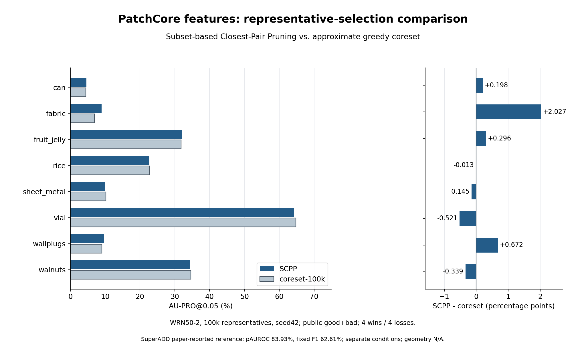

# PatchCore 특징에서 selector만 교체한 실험

## 목적과 통제

DINO에서 관측한 SCPP를 다른 특징 공간에 적용했을 때 효과를 확인한다. 두 방법에 공통인 WRN50-2 특징을 한 번 추출한 뒤 대표 선택 규칙만 바꿨다.

| 항목 | 공통 조건 |
|---|---|
| 입력 | 전체 화면 256×256, crop 없음 |
| backbone | WRN50-2, ImageNet1K V1 |
| 특징 | 공식 layer2+layer3, 3×3 patch, fused 1024D FP32 |
| 선택 공간 | 같은 1024→128D random linear projection, 정규화 없음 |
| 대표 예산 | 각 100,000개의 실제 FIT 특징 |
| coreset | 공식 approximate greedy, 시작점10개 |
| SCPP | 100개 부분집합 × 1000개, closest-pair pruning |
| 점수 | 원본 1024D bank의 exhaustive FP32 squared-L2 1NN |
| 분할 | train FIT 2528 / 공식 정상 validation 302 / public good 379 + bad 705 |
| 평가 | 원본 quarter grid, GT INTER_LINEAR>0, 8-connected component, FP32 score |
| 반복 | seed42 한 번 |

원 논문의 기본 1% bank, 여러 backbone ensemble 또는 DINO raw1280D bank를 재현한 실험이 아니다. DINO의 FP16 cache/score와도 구분한다.

## 범주별 AU-PRO@0.05

모든 수치는%이며 각 범주별로 계산한다.

| 범주 | SCPP | coreset100k | 차이(%p) |
|---|---:|---:|---:|
| can |4.6594|4.4617|+0.1977|
| fabric |8.9598|6.9326|+2.0272|
| fruit_jelly |32.128|31.832|+0.296|
| rice |22.665|22.678|−0.013|
| sheet_metal |10.086|10.232|−0.145|
| vial |64.232|64.753|−0.521|
| wallplugs |9.756|9.084|+0.672|
| walnuts |34.285|34.624|−0.339|
| 8범주 평균 |23.3465|23.0747|+0.2718|

범주별 4승4패다. 평균 상승은 주로 fabric에서 나왔고 나머지 7범주 평균 차이는 약 +0.021%p다. AU-PRO@0.30과 pixel AUROC는 CP가 낮았다. 이 한 번의 설정으로 일관된 성능 우위를 확인하지 못했다. 정확한 자릿수와 전체 지표는 [CSV](../results/patchcore/per_category.csv), [macro JSON](../results/patchcore/macro.json)을 기준으로 한다.

Q99 F1은 정상 validation pixel score의 99th percentile로 threshold를 정한 public good+bad pooled 값이다. SuperADD paper-reported fixed F1과 비교할 수 없다. 외부 참고값은 SuperADD 8범주 pAUROC 83.93%, fixed F1 62.61%이며, 이 PatchCore 표와 직접 차이나 순위를 계산하지 않는다.

## 시간과 수치 검증의 범위

8범주 합계 대표 선택+bank 저장은 SCPP 40.79초, coreset 178.87초였다. 캐시 기반 1NN+저장은 13.20초, 13.16초다. 전체 generation 378.43초에는 공유 특징 추출·양쪽 선택·예측·해시가 포함된다. 별도 반복 benchmark나 end-to-end latency 측정이 아니다.

역사 검증은 작은 CPU/H100 고정 입력에서 공식 coreset의 ID 일치, 실제 표본의 직접 FP64 거리 대조, 실제 can 전체 public pixel에서 sklearn metric 대조, 16조건 confusion count와 macro 재계산을 포함했다. 표본 거리 검증을 모든 query의 bitwise 검증으로 확대하지 않는다.

현재 공개 저장소에는 그 실험의 결과표와 출처 SHA가 있으며 전체 WRN 특징 추출·공식 coreset 실행 pipeline을 배포하지 않는다. 원래 구현은 [PatchCore 공식 코드](https://github.com/amazon-science/patchcore-inspection)를 참고한다.
